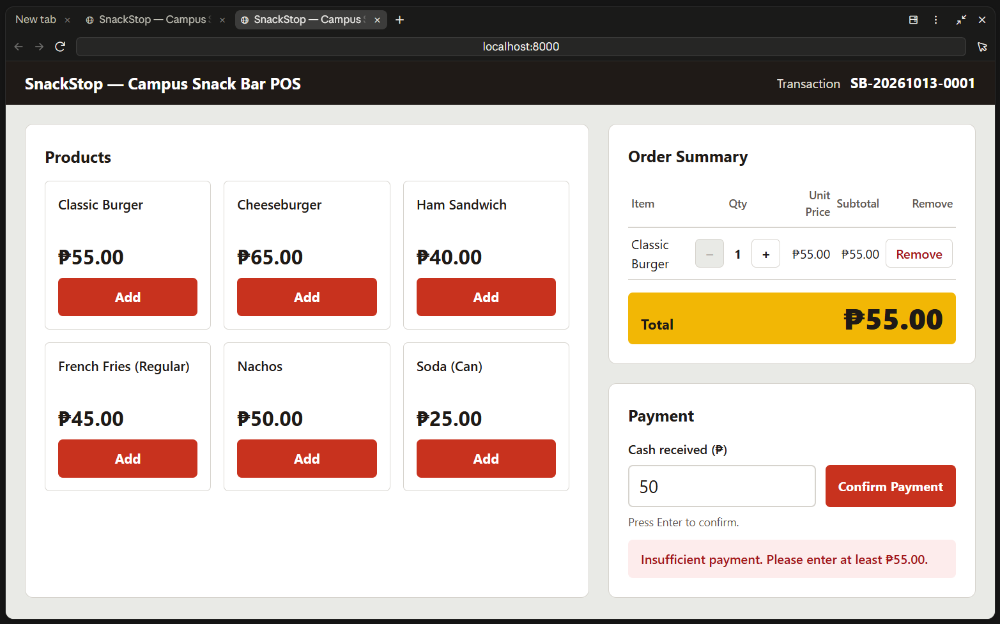
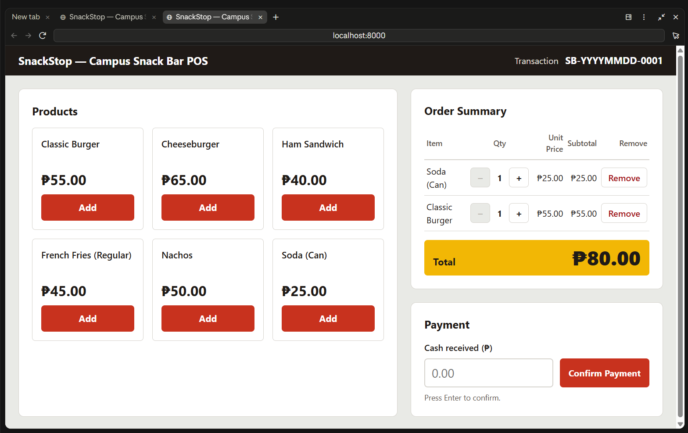
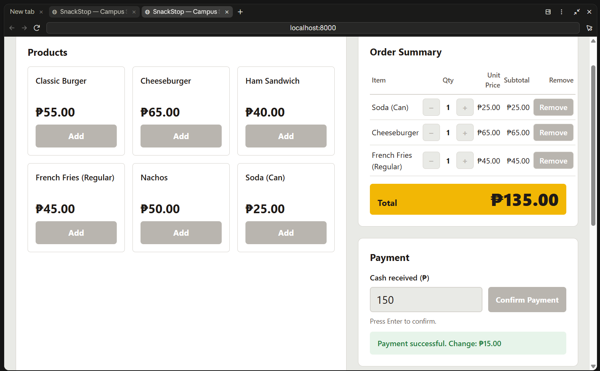
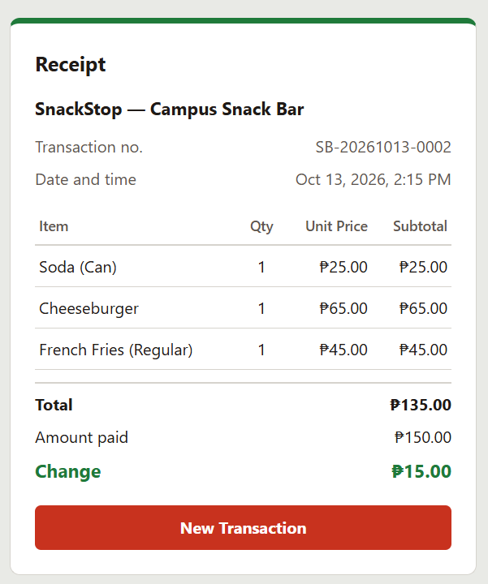

<!-- Evaluation, Modifications, and Lessons Learned are drafts written from
     docs/AI_LOG.md. Rafael: rewrite them in your own words before submitting. -->

# SnackStop — Campus Snack Bar POS

**IT 415 – Application Development and Emerging Technologies**
**Midterm Examination (Performance-Based)** · First Semester, AY 2026–2027
**Student:** Rafael [SURNAME] · **Date:** October 13, 2026
**Scenario:** Scenario 4 — Campus Snack Bar POS (desktop food ordering and POS)
**GitHub repository:** [REPO URL]

---

## 1. Requirements Analysis

### 1.1 Problem to be addressed
A campus snack bar cashier has to total orders, take cash, and work out
change quickly during busy breaks. Mental math and paper slips lead to wrong
totals, wrong change, and no record of the sale. SnackStop gives the cashier
one screen that builds the order, checks the payment, computes the change,
and prints a digital receipt with a transaction number.

### 1.2 Target users
| User | What they need from the system |
|------|-------------------------------|
| Cashier | Add items fast, see the total at a glance, enter cash, get the exact change, start the next sale |
| Customer | A correct total and change, and a receipt they can check |

### 1.3 Objectives
**General objective:** Build a working desktop POS web app for a campus
snack bar that takes a customer from browsing products to a paid order with
a digital receipt, with correct totals, validated cash payment, and change.

**Specific objectives:**
1. Let the cashier build an order from 6 hard-coded products, change
   quantities (1–99), and remove items, with subtotals and the total
   recomputed on every change.
2. Accept a cash amount and reject blank, non-numeric, negative, over-limit,
   and insufficient amounts with clear messages, then compute change exactly
   (integer centavos, no float errors).
3. Confirm the payment and show a digital receipt with a unique
   `SB-YYYYMMDD-NNNN` transaction number, then reset everything for the next
   customer with "New Transaction".

### 1.4 Transaction flow (Section IV)
Browse Products → Add to Cart → Review Order → Enter Payment → Validate &
Compute → Confirm Payment → Receipt / New Transaction

### 1.5 Required features and where each is met (Section V)
| # | Required feature | Where it is met |
|---|------------------|-----------------|
| 1 | At least 5 products with names and prices | 6 products in `js/products.js`, drawn as cards by `buildProducts()` in `js/app.js` |
| 2 | Add to cart with on-screen buttons | "Add" button on each card → `addToCart()` in `js/logic.js` |
| 3 | Increase and decrease quantity | + and − on each cart line → `increaseQty()` / `decreaseQty()` (limits 1 and 99; buttons disabled at the limits) |
| 4 | Remove a product | "Remove" on each cart line → `removeItem()` |
| 5 | Subtotals and total recomputed on every change | `lineSubtotal()` / `cartTotal()`; every cart action goes through `updateCart()` → `render()` |
| 6 | Clear order summary | Order Summary table (Item, Qty, Unit Price, Subtotal, Remove), "Your cart is empty.", yellow Total bar |
| 7 | Cash payment in a numeric field | `<input type="number" step="0.01" min="0">` in the Payment section; Enter or "Confirm Payment" submits |
| 8 | Reject blank, non-numeric, negative, insufficient amounts with clear messages | `validatePayment()` (also rejects 3+ decimals and over ₱100,000.00); message shown in a `role="alert"` box |
| 9 | Change = amount paid − total | `computeChange()` |
| 10 | Payment confirmation | "Payment successful. Change: ₱X.XX" |
| 11 | Digital receipt with items, quantities, subtotals, total, amount paid, change, and transaction number | `buildReceipt()` + `renderReceipt()`: store name, SB-YYYYMMDD-NNNN, date and time, item table, total, amount paid, change |
| 12 | New Transaction clears the cart, payment, and receipt | "New Transaction" button: empties cart, field, messages, hides receipt, next transaction number |

### 1.6 Required inputs
| Input | Type | Rules |
|-------|------|-------|
| Product selection | Button click (Add) | One of the 6 products |
| Quantity | Button click (+ / −) | Whole number 1 to 99 |
| Cash received | Number field (₱) | Not blank; digits with up to 2 decimals; not negative; at most ₱100,000.00; at least the total |

### 1.7 Expected outputs
- Order Summary with each line's quantity, unit price, subtotal, and the total
- A specific error message for each invalid payment
- "Payment successful. Change: ₱X.XX"
- A receipt with store name, transaction number, date and time, items, total, amount paid, change

### 1.8 Proposed application features
| Feature | Input | Processing | Output |
|---------|-------|------------|--------|
| 1. Order building (cart) | Click "Add"; click +, −, Remove | `addToCart` / `increaseQty` / `decreaseQty` / `removeItem` return a new cart; `lineSubtotal` and `cartTotal` recompute | Order Summary lines and total; "Added: <name>"; "Your cart is empty." when empty |
| 2. Payment and change | Cash typed in the field; Confirm Payment or Enter | `validatePayment(text, totalCents)` checks every rule; `computeChange(paid, total)` | Error message under the field, or "Payment successful. Change: ₱X.XX" |
| 3. Receipt and new transaction | Valid payment; click "New Transaction" | `buildReceipt(...)` snapshots the sale; `nextTransactionNumber` gives the next number | Receipt section; cart and payment locked; New Transaction clears all and shows the next number |

### 1.9 Development tools and technologies
| Area | Tool / technology | Why |
|------|-------------------|-----|
| Frontend | HTML, plain CSS, vanilla JavaScript | The exam allows hard-coded products and no database; no build step, nothing to break during the demo |
| Backend | None | Not needed: all data is in memory (Section VII: no database, login, or deployment) |
| Database | None | Out of scope per the exam; data lives in memory only |
| Local server | `python -m http.server 8000` | Already installed (Python 3.12.10); serves the files |
| Testing | Node.js built-in test runner (`node --test`, Node v24.15.0) | Already installed; no packages needed |
| Version control | Git + GitHub | Required; tracks development history |
| AI tools | Claude Code (desktop app) with Superpowers, UI UX Pro Max, Frontend Design | Planning, test-driven code generation, debugging, refactoring, documentation |

---

## 2. AI-Assisted Development (Section VIII)

All AI work was done in Claude Code, one checkpoint at a time: the AI did one
step, showed the evidence (test output, browser results, `git status`), and
waited for my "Proceed to Step N". The full log is in [AI_LOG.md](AI_LOG.md).

### 2.1 Planning / requirements analysis

**Prompt used (exact):**
```
Context: I'm taking my IT 415 Midterm Practical Exam with about 2 hours
left. Read CLAUDE.md first: it has my rules, the stack (Kit B), and every
scenario rule. My scenario is Scenario 4, Campus Snack Bar POS, a
desktop food ordering and POS app.

Required transaction flow: Browse Products → Add to Cart → Review Order →
Enter Payment → Validate & Compute → Confirm Payment → Receipt / New
Transaction.

Required features: (1) at least 5 products with names and prices;
(2) add to cart with on-screen buttons; (3) increase and decrease
quantity; (4) remove a product; (5) subtotals and total recomputed on
every change; (6) clear order summary; (7) cash payment in a numeric
field; (8) reject blank, non-numeric, negative, and insufficient amounts,
each with a clear message; (9) change = amount paid − total;
(10) payment confirmation; (11) digital receipt with items, quantities,
subtotals, total, amount paid, change, and a transaction number;
(12) New Transaction clears the cart, payment, and receipt.

Objective: Plan the build before any code.

Requirements:
- No clarifying questions unless something truly blocks you; CLAUDE.md
  already answers the scenario rules.
- Write: the general objective and 3 specific objectives, the 3 features
  as Input → Processing → Output, the list of pure functions in logic.js
  with what each returns, the validation table (input → rule → message),
  and a table mapping each of the 12 required features to the step that
  builds it.
- Steps, in order, each with what gets built and how we verify it:
  Step 1 Initial project setup (files, .gitignore, README stub, check
  node --version, test setup, git init)
  Step 2 Create application interface (all 4 sections, static)
  Step 3 Implement core functionality: cart, quantities, remove, totals
  (TDD)
  Step 4 Implement core functionality: payment, change, confirmation,
  receipt, new transaction (TDD)
  Step 5 Add input validation (every payment rule + empty cart)
  Step 6 Fix application error (reserved for a real error)
  Step 7 Refactor application code
  Step 8 Update documentation
- List edge cases my instructor might try in the demo.

Constraints: fit about 1 hour 15 minutes of building. No code yet. No
branches. No new dependencies.

Expected output: the plan ready to save as docs/PLAN.md, plus a short
summary. Stop and wait for my approval.
```

| | |
|---|---|
| **Purpose** | Get a complete, step-by-step plan before any code, so a wrong direction is caught early. |
| **AI response** | Checked Node (v24.15.0) and Python (3.12.10), then wrote [PLAN.md](PLAN.md): objectives, 3 features as Input → Processing → Output, 12 pure functions for `logic.js`, a validation table with exact messages, a feature-to-step map, design decisions (integer centavos, regex parsing, plain CSS instead of the Tailwind CDN, no storage.js), 8 steps with tests and checks, and 16 demo edge cases. |
| **Evaluation** | **Partially correct.** It covered all 12 features and every scenario rule, and explained its two changes from the kit. But the test command it planned, `node --test tests/`, does not work on Node 24; this was caught when it was run in Step 1. |
| **Modifications** | Approved plain CSS. Said I would take the screenshots myself. Required this document to follow Section VIII with a screenshots section. Capped the Step 6 edge-case run at 10 minutes. The test command was changed to `node --test`. |

### 2.2 Application / code generation

Code was generated test-first (red → green) in Steps 3 and 4.

**Prompt used (exact), Step 3:**
```
keep the bug for Step 6...

Proceed to Step 3 of docs/PLAN.md.

Context: The static interface is done. We're implementing the cart
(Section V features 1–6).

Objective: Make adding, changing quantity, removing, and totals work end
to end.

Requirements:
- Test-driven: write the tests from Step 3 of docs/PLAN.md in
  tests/logic.test.js first, run them and show them FAILING, then write
  the code in js/logic.js and show them PASSING.
  Functions: formatPeso, addToCart, increaseQty, decreaseQty,
  removeItem, lineSubtotal, cartTotal. All money in integer centavos.
  Cart functions return a new array and never mutate the input.
- js/products.js: the 6 products with ids p1–p6 and priceCents.
- js/app.js: render the product cards from products.js, wire Add, +, −,
  Remove; show "Added: <name>" briefly; disable − at qty 1 and + at 99;
  show "Your cart is empty." and Total ₱0.00 when empty; re-render the
  order summary and total after every change. Use textContent only.

Constraints: no payment logic yet. Don't change the layout except to wire
it. No new dependencies.

Expected output: RED and GREEN test output, a 2–3 line explanation of
the design, what to click in the browser to check it, and a commit
"Implement core functionality: add to cart, change quantity, remove
items, and recompute totals". Then stop.
```

**Prompt used (exact), Step 4:**
```
Proceed to Step 4 of docs/PLAN.md.

Context: The cart works. We're implementing Section V features 7 and 9–12:
cash payment, change, confirmation, receipt, and new transaction.

Objective: Complete one full transaction from payment to receipt to a new
transaction.

Requirements:
- Test-driven: write the Step 4 tests from docs/PLAN.md first and show
  them FAILING, then implement parsePaymentToCents, computeChange,
  nextTransactionNumber, buildReceipt, and the happy path of
  validatePayment, and show them PASSING.
- Wire the payment form (Confirm Payment button and Enter key): on a valid
  payment, show "Payment successful. Change: ₱X.XX", then show the
  receipt with store name, transaction number (SB-YYYYMMDD-NNNN), date and
  time, each item with qty, unit price, and subtotal, total, amount paid,
  and change.
- While the receipt is shown, disable the Add, +, −, Remove buttons and
  the payment form.
- "New Transaction" clears the cart, payment field, messages, and
  receipt, increases the transaction number, and updates the header.

Constraints: only the happy path of validation here; full validation is
Step 5. Don't change the cart functions' behavior.

Expected output: RED and GREEN test output, a 2–3 line explanation, what
to try in the browser (Burger + Soda = ₱80.00, pay 100 → change ₱20.00,
then New Transaction → -0002), and a commit "Implement core
functionality: cash payment, change, confirmation, receipt, and new
transaction". Then stop.
```

| | |
|---|---|
| **Purpose** | Build the cart (features 1–6) and the payment-to-receipt flow (features 7, 9–12), each proven by tests written first. |
| **AI response** | Step 3: 17 tests written first; red run showed 17 failures with `TypeError: formatPeso is not a function`; then the 7 cart functions; green run 18/18. Step 4: 12 tests first; red run 12 failures (`parsePaymentToCents is not a function`); then `parsePaymentToCents`, `validatePayment` (happy path), `computeChange`, `nextTransactionNumber`, `buildReceipt`; green 30/30. `app.js` got the click handlers, the receipt, locking, and New Transaction. |
| **Evaluation** | **Correct.** Tests failed for the right reason before the code existed, then passed. In the browser: Burger + Soda = ₱80.00, paid 100 → "Payment successful. Change: ₱20.00", receipt SB-20261013-0001, everything locked; New Transaction → SB-20261013-0002. The AI also pointed out a gap it had left for Step 5 (an empty cart could be "paid" with 0). |
| **Modifications** | Asked to keep a layout bug found after Step 2 for the debugging step instead of fixing it then. |

### 2.3 Input validation

**Prompt used (exact), Step 5:**
```
Proceed to Step 5 of docs/PLAN.md.

Context: A full transaction works for valid input.

Objective: Reject every invalid payment with a clear on-screen message
(Section V feature 8).

Requirements:
- Test-driven: write every Step 5 test from docs/PLAN.md first (blank,
  spaces, "abc", "12a", "-5", "50.123", "1e3", "100000.01" → "Please
  enter a valid payment amount."; "50" and "0" with a ₱55.00 total →
  "Insufficient payment. Please enter at least ₱55.00."; exact "55" and
  "100000" → ok). Show them FAILING, then PASSING.
- UI: show the message in the role="alert" area, clear it when the field
  changes, keep focus in the field, disable payment when the cart is
  empty, and re-check for an empty cart inside the submit handler.
- Then run through the validation table in the browser and report what
  each case shows. Report any problem you find; don't fix it in this
  step, so we can fix it properly in Step 6.

Constraints: valid payments must behave exactly as before. Don't remove
or weaken tests.

Expected output: a table (input → message shown), the real test output,
and a commit "Add input validation: reject blank, non-numeric, negative,
over-limit, and insufficient payments". Then stop.
```

| | |
|---|---|
| **Purpose** | Reject every invalid payment with a clear message (feature 8). |
| **AI response** | 11 tests written first; 3 failed (over-limit accepted; "50" and "0" got the generic message), and 8 passed immediately because Step 4's strict parsing already rejected them. The AI said so instead of hiding it, and kept them as regression tests. Added the ₱100,000.00 limit and the insufficient message; 41/41 pass. Ran 14 cases by typing in the browser and reported 3 problems without fixing them. |
| **Evaluation** | **Correct.** Every rule works in the tests and in the browser. It also found real problems: the page scrolled sideways on narrow screens, the number field drops letters (`12a` → 12), and an old message stayed after the cart changed. |
| **Modifications** | Chose which problems to fix in Step 6 (two of them); the letter-dropping is listed as a known limitation. |

### 2.4 Debugging

**Prompt used (exact):**
```
Proceed to Step 6 ...

also want #3 fixed...
```

| Problem | AI response (root cause) | Fix | Test result |
|---------|--------------------------|-----|-------------|
| Page 524px wide on a 375px phone, so it scrolled sideways and cut off receipt amounts | Measured each part: the one-column grid used `1fr`, which never gets narrower than its widest content (payment row 458px, 5-column cart table ~410px). The first fix tried (`minmax(0, 1fr)` alone) shrank the page only to 435px, which showed the table was a second cause. | `grid-template-columns: minmax(0, 1fr)` + a `.table-scroll` wrapper (`overflow-x: auto`) around the cart and receipt tables | Page width 375px at 375px with cart and with receipt; desktop 1366×768 unchanged; 41/41 tests pass |
| After "Insufficient payment. Please enter at least ₱55.00.", adding Soda made the total ₱80.00 but the message still said ₱55.00 | The payment message was only cleared when typing in the field or on New Transaction; the cart buttons never cleared it | Every cart action goes through one function that clears the message (and the amount when the cart becomes empty) | Message cleared after adding Soda; paying 50 again says "at least ₱80.00"; paying 100 still gives ₱20.00 change; 41/41 tests pass |

**Evaluation:** **Correct.** Both fixes target the measured root cause and
were checked before and after. One false alarm: the first re-check still
showed 524px because the browser was using cached old files; reloading fresh
files confirmed the fix. Bug 3 has no automated test because it is page
behaviour and `logic.js` did not change; it was checked in the browser.
**Modifications:** I kept bug 1 from Step 2 on purpose so it could be fixed
properly here, and asked for bug 3 to be fixed too. Each fix is its own
commit.

Evidence: 


### 2.5 Refactoring / code improvement

**Prompt used (exact):**
```
Proceed to Step 7 of docs/PLAN.md.

Context: All tests pass right now.

Objective: Refactor for readability with no change in behavior. Planned
targets: one render() that draws every section from state, and named
constants MAX_QTY = 99, MAX_PAYMENT_CENTS = 10000000, and STORE_NAME
instead of magic numbers. If something else is messier in the real code,
pick that and tell me why.

Requirements:
- Run `node --test tests/` first and show the output (before).
- Show the before code and explain the problem in 2 lines, then change it.
- Run the tests again and show the output (after), with the same count.
- Do one quick full transaction in the browser to confirm nothing broke.

Constraints: BEHAVIOR MUST NOT CHANGE. Don't touch the tests. Don't
change messages or the layout.

Expected output: before code, after code, reason, both test outputs, and
a commit "Refactor application code: [what changed]". Then stop.
```

| Before | After | Test result |
|--------|-------|-------------|
| Three ways to update the screen: `renderAll()`, a partial `onCartChanged()`, and direct `setPaymentMessage()` writes; the payment message lived only in the page, not in state | The message is part of state; one `render()` draws every section; every handler is "change state → `render()`"; cart actions go through `updateCart()`; product cards built once; nested ternary replaced by a column list; `2000` named `ADDED_MESSAGE_MS` | 41 passed before → 41 passed after |

**Why this refactor:** The planned constants and a full redraw function
already existed, so the AI picked the messier part: every handler had to
remember which parts of the screen to redraw, which is exactly how bug 3
happened.
**Evaluation:** **Correct.** Same test count; the same full transaction in
the browser gave the same messages, receipt, locking, focus, and next
transaction number. `node --test tests/` itself still fails on Node 24, so
`node --test` was used.
**Modifications:** None.

### 2.6 Documentation

**Prompt used (exact):**
```
Proceed to Step 8 of docs/PLAN.md.

Context: SnackStop is finished, tested, fixed, and refactored.

Objective: Write the submission documentation for the exam.

Requirements:
- README.md: what the app does, the transaction flow (Section IV), how to
  run it (python -m http.server 8000), how to run tests (node --test
  tests/), and the file structure.
- docs/DOCUMENTATION.md, based on docs/DOCUMENTATION_TEMPLATE.md:
  - System title, scenario, general objective, and 3 specific objectives
    from docs/PLAN.md.
  - The 12 required features and where each is met.
  - AI-Assisted Development (exam Section VIII), from docs/AI_LOG.md. For
    each AI use (planning, code generation, validation, debugging,
    refactoring): exact prompt used, purpose, AI response summary,
    evaluation (correct / partially correct / incorrect and why), and
    modifications made.
  - GitHub section: repo URL placeholder, the commands used, and the real
    output of git log --oneline.
  - Design decisions with one-line reasons (integer centavos, regex
    parsing instead of parseFloat, immutable cart functions, plain CSS
    instead of Tailwind CDN, in-memory data).
  - Screenshot placeholders: product list, cart, payment, receipt,
    validation error, GitHub commit history.
- docs/TESTING.md: a table (Test | Description | Input | Expected |
  Actual | Status) with valid, invalid, and edge cases from the real
  tests, plus the real `node --test tests/` summary.
- Finish docs/AI_LOG.md.

Constraints: only describe what really exists and really happened. Don't
invent results. Leave [SCREENSHOT] placeholders.

Expected output: the files and a commit "Update documentation: README,
testing results, AI log, and project documentation". Then stop.
```

| | |
|---|---|
| **Purpose** | Write the README, testing results, and this document from what really happened. |
| **AI response** | Wrote README.md, docs/TESTING.md (39 automated test rows + 14 manual browser tests + a known limitation), this document, and the last AI log entry. Used the real `git log --oneline` and test output. Wrote `node --test` instead of `node --test tests/` because the latter really fails on Node 24, and said so. |
| **Evaluation** | [Rafael: correct / partially correct / incorrect, and why] |
| **Modifications** | [Rafael: what you rewrote in your own words] |

### 2.7 Responsible AI use
- No passwords, API keys, or personal data were put in prompts.
- Every AI output was read, run, and tested before it was committed: test
  output and browser results were shown at every step, and `git status`
  before every commit.
- Things I rejected or corrected:
  - The planned test command `node --test tests/` failed on Node 24 and was
    replaced with `node --test`.
  - A design check flagged the thick coloured stripes the AI had put on the
    product cards and the receipt as clashing with the rounded corners;
    both were removed.
  - The AI wanted to fix the narrow-screen layout bug right after Step 2; I
    had it undone and fixed properly in Step 6 as a real, documented error.

---

## 3. GitHub and Version Control

### 3.1 Workflow used
1. Created an empty repository on GitHub: [REPO URL]
2. `git init -b main` in the project folder (done in Step 1)
3. After each verified step: `git status`, then `git add -A` and `git commit`
4. `git remote add origin [REPO URL]`
5. `git push -u origin main` the first time, then `git push` after each commit

All work was done on the `main` branch, with no other branches and no pull requests.

### 3.2 Development history
| # | Required stage | Commit message |
|---|----------------|----------------|
| 1 | Initial project setup | Initial project setup: create Kit B folders, .gitignore, README, plan, and test runner |
| 2 | Create application interface | Create application interface: static layout for products, order summary, payment, and receipt |
| 3 | Implement core functionality | Implement core functionality: add to cart, change quantity, remove items, and recompute totals |
| 3 | Implement core functionality | Implement core functionality: cash payment, change, confirmation, receipt, and new transaction |
| 4 | Add input validation | Add input validation: reject blank, non-numeric, negative, over-limit, and insufficient payments |
| 5 | Fix application error | Fix application error: stop the page scrolling sideways on narrow screens |
| 5 | Fix application error | Fix application error: clear the old payment message when the cart changes |
| 6 | Refactor application code | Refactor application code: redraw every section from state through one render() |
| 7 | Update documentation | Update documentation: add screenshots and my evaluation |
| 7 | Update documentation | Update documentation: README, testing results, AI log, and project documentation |

`git log --oneline` output (before the final documentation commit):
```
80dff6b Update documentation: add screenshots and my evaluation
d7b2f90 Refactor application code: redraw every section from state through one render()
28ab089 Fix application error: clear the old payment message when the cart changes
829196e Fix application error: stop the page scrolling sideways on narrow screens
1042284 Add input validation: reject blank, non-numeric, negative, over-limit, and insufficient payments
360909a Implement core functionality: cash payment, change, confirmation, receipt, and new transaction
305a7e5 Implement core functionality: add to cart, change quantity, remove items, and recompute totals
41a9c10 Create application interface: static layout for products, order summary, payment, and receipt
0f778c7 Initial project setup: create Kit B folders, .gitignore, README, plan, and test runner
```

[SCREENSHOT of the commit history page on GitHub]

---

## 4. Testing and Validation

Full results: [TESTING.md](TESTING.md). Summary:

| Test | Description | Input | Expected result | Actual result | Status |
|------|-------------|-------|-----------------|---------------|--------|
| 1 | Valid input | Burger + Soda (₱80.00), pay `100` | Change ₱20.00, receipt | "Payment successful. Change: ₱20.00", receipt SB-20261013-0001 | PASS |
| 2 | Invalid input | `-5`, `abc`, `1e3`, `50.123`, blank | "Please enter a valid payment amount." | Same message for each | PASS |
| 3 | Invalid input | `50` for a ₱55.00 total | "Insufficient payment. Please enter at least ₱55.00." | Same | PASS |
| 4 | Edge case | Exact payment `55` | Change ₱0.00 | "Payment successful. Change: ₱0.00" | PASS |
| 5 | Edge case | `100000.01` / `100000` | Rejected / accepted | Rejected / accepted | PASS |
| 6 | Edge case | + at qty 99, − at qty 1 | Stays 99 / stays 1 | Stays 99 / stays 1 (buttons disabled) | PASS |
| 7 | Edge case | Empty cart | Payment disabled | Cash field and Confirm Payment disabled | PASS |

Automated tests: `41 passed` (`node --test`, Node v24.15.0).

```
ℹ tests 41
ℹ pass 41
ℹ fail 0
```

[SCREENSHOT of the `node --test` output]

**Known limitation:** the browser's number field silently drops letters, so
typing `12a` submits 12. The field shows the cleaned number, so the cashier
sees what will be charged.

---

## 5. Implementation Decisions

| Decision | Why |
|----------|-----|
| Money stored as integer centavos | `0.1 + 0.2` is not `0.3` in JavaScript; whole centavos make totals and change exact. |
| Payment parsed with a regex, not `parseFloat` | `parseFloat("12abc")` returns 12, and `55.05 * 100` gives 5504.999…; reading the digits avoids both. |
| Cart functions return a new array (immutable) | Every action is "new cart = function(old cart), then render", so they are simple to test and can't change data by accident. |
| Plain CSS instead of the Tailwind CDN | The CDN needs internet; a local CSS file cannot fail during the demo. |
| In-memory data only | The scenario says no database; a page refresh starts over and the transaction counter restarts at 0001. |
| One `render()` from state | The screen is always drawn from the data, so they cannot disagree (this removed the cause of bug 3). |
| `textContent` only, never `innerHTML` | Nothing typed can run as HTML. |
| `logic.js` has no DOM code | Every rule can be tested in Node without a browser. |

---

## 6. Final System Screenshots

1. Product list: 
2. Cart: 
3. Payment: 
4. Receipt: 
5. Validation error: 
   
6. GitHub commit history: [SCREENSHOT]
7. Phone-width view: [SCREENSHOT]

---

## 7. Lessons Learned

- AI did well: test-first code meant every function was proven before it
  was used, and the browser checks used real clicks and typing.
- AI got wrong: the planned test command did not work on Node 24, and its
  first fix for the layout bug only solved half of it; both were caught
  because the result was measured, not assumed.
- Git/GitHub: small commits with clear prefixes make the history tell the
  story of the build; keeping a real bug for the "Fix" commit needed
  care (undo the fix, commit other work, then fix it properly).
- Next time: test at phone width from the first interface step, and use a
  text field with my own validation instead of a number field, so letters
  get an error message instead of being dropped silently.
